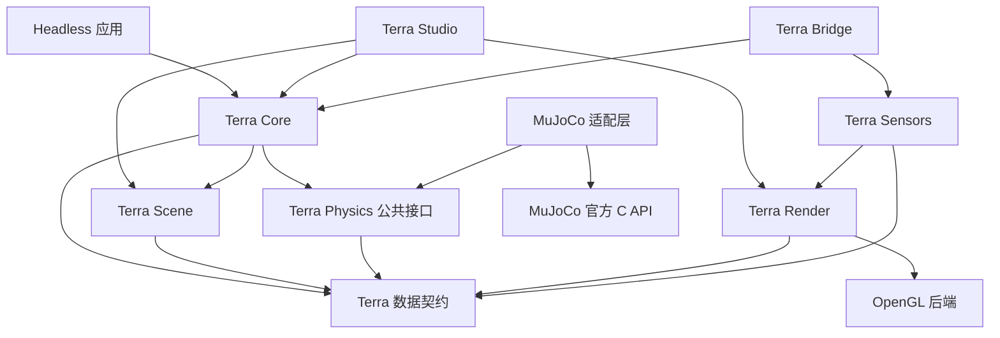
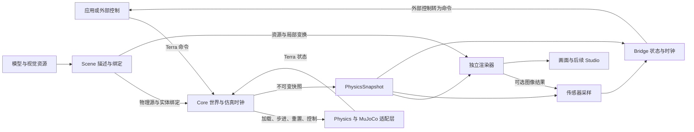

# EAI Terra 技术架构与设计方案

> 设计基线：独立引擎、C++17、MuJoCo 首后端、自研 OpenGL 渲染、物理与渲染解耦。当前仅有工程、构建信息和 CLI 骨架，无物理或渲染功能实现。除[决策记录](DECISIONS.md)列为已确定的原则外，下述物理接口、数据契约及执行细节均为**初版建议，尚未技术验证**，不是最终 API。

## 1. 架构目标与阶段边界

EAI Terra 的架构核心是 Terra 自己维护的仿真世界、实体与生命周期。MuJoCo 负责具体模型的动力学计算，不拥有 Terra 的场景系统、资源系统、应用协议或渲染架构。

M0 只需要最小 Core、Physics 适配和 Headless 应用。Render、完整 Scene、Sensors、Bridge、Studio 在对应阶段逐步加入。M0 允许一个已编译 MJCF 表达整个物理世界；这是一项初期集成边界，不意味着用 `mjModel` 取代 Terra 世界，也不承诺现阶段任意运行时拓扑编辑。

### 1.1 模块职责

| 模块 | 职责 | 不应承担的职责 | 首次实质建设 |
| --- | --- | --- | --- |
| Terra Core | 世界生命周期、仿真时钟、运行命令、稳定 ID、发布状态；协调场景和物理接口 | 动力学求解、图形 API、ROS2 消息定义 | M0 最小子集 |
| Terra Physics | 后端无关物理接口、模型与控制适配、状态转换、接触摘要和诊断 | 上层场景所有权、可视化资源管理、图形上下文 | M0 |
| Terra Render | 网格、材质、相机、光照和绘制；读取 Terra 场景与状态 | 直接读取 MuJoCo 数据、修改物理积分结果 | M1 起 |
| Terra Scene | 场景描述、实体拓扑、模型实例与资源引用、物理/视觉绑定 | 自己推进物理时间、依赖某个图形 API 存储世界状态 | M2；M0 仅保留必要元数据 |
| Terra Sensors | 传感器配置、采样时刻、标定、真值与噪声；可选图像数据生成 | 要求纯物理运行必须有 GPU，代替控制器决定动作 | M4 |
| Terra Bridge | ROS2、Python 等可选适配、时间和坐标转换、命令入口 | 将外部运行时依赖带入物理核心，直接写后端内存 | M4 / M5 |
| Terra Studio | 浏览、调试、属性操作和后续编辑工具 | 越过 Core/Physics 接口修改求解器状态 | M5 候选工具范围 |

### 1.2 目标模块依赖图

以下 Mermaid 的实线箭头表示“依赖右端提供的接口”，不表示数据流，也不表示这些模块已经存在。`Terra 数据契约` 是建议的底层公共类型目标，规划位于 `engine/core/` 的独立子目标；它不依赖 Core 运行实现，避免 Physics ↔ Core 循环链接。

Core 只面向 Physics 接口，由应用组合入口选用 MuJoCo 实现；适配层实现 Physics 接口并私有链接官方库。图中的 Sensors → Render 是**图像传感器可选依赖**，IMU 等物理传感器不要求 Render。未来 Vulkan 的依赖只应出现在 Render 内部，不向 Core 传播。

### 1.3 运行数据流

下图箭头表示运行数据的方向。它与上图的接口依赖含义不同。

渲染层对物理状态没有反向写通道；拾取、拖动和工具操作若影响物理，必须转为显式 Core 命令，在确定的步边界执行。

## 2. MuJoCo 集成与封装

### 2.1 已确定的集成原则

1. 首期优先使用 MuJoCo 官方库及 C API，不通过 Python 封装层承载核心循环。
2. 第一阶段不修改 MuJoCo 内核源码，不维护私有求解器分支。
3. MuJoCo 自带的可视化或渲染器不作为 Terra 最终渲染方案；M0 也不调用其渲染接口。
4. MuJoCo 头文件、`mjModel`、`mjData`、对象索引及释放逻辑均限制在私有适配层。上层只能接触 Terra 描述符、ID 和数据副本。
5. 版本必须经兼容验证后锁定。目前 README 没有指定版本，也没有版本验证证据；本设计不指定某个版本已经可用。

MuJoCo 的官方定位是具有 C API 的物理库；该事实支持把它作为可嵌入后端，见[官方概览](https://mujoco.readthedocs.io/en/stable/overview.html)。本项目对世界、模块和数据的划分属于 Terra 的设计选择，不是上游替项目做出的保证。

### 2.2 建议加载与资源生命周期

- `loadModel` 在后端解析并编译 MJCF，返回 Terra 模型描述；Core 据此分配实体与实例标识，建立绑定。
- `initialize` 分配运行数据，接收固定步长及绑定，生成初始状态。模型解析、运行数据和世界注册失败时应回滚，不能留下可步进的半初始化对象。
- 官方 API 的 `mj_loadXML` 负责 XML 加载/编译，`mj_makeData` 建立运行数据；通过相应删除函数释放。建议使用 C++ RAII 管理，确保运行数据在关联模型之前释放。这些 API 的契约见[官方函数参考](https://mujoco.readthedocs.io/en/stable/APIreference/APIfunctions.html)。
- M0 每个世界只有一个活动模型；再次加载须走显式销毁/重建流程。运行时增加机器人、增删关节或修改拓扑延至场景设计评审后决定，不能直接改上游结构掩盖语义缺失。
- 正常加载/参数错误转为 Terra 错误结果；数值警告记录并按策略中止。部分底层严重错误可能终止进程，需核查所锁定版本，不能承诺所有 C API 调用都可安全捕获为 C++ 异常。不可恢复错误在子进程用例中验证，不在 M0 引入复杂恢复框架。

### 2.3 建议步后观测策略

MuJoCo 步进先计算动力学再积分，部分派生字段可能仍表示积分前状态。不能将步后的时间与未经刷新的 `xpos/xquat` 混合发布。该行为及状态一致性说明见[官方仿真指南](https://mujoco.readthedocs.io/en/stable/programming/simulation.html)。

M0 为正确性优先，建议在初始化、reset 和每次步进后，在适配层调用一次完整的 `mj_forward` 刷新当前状态派生量，然后只发布该观测时刻的数据。它不推进仿真时间，但会重算动力学与接触，增加成本并影响内部缓存；应验证其对下一步与重复运行的影响，记录进测量配置。M0 不使用有外部副作用的全局控制回调；控制在步边界明确写入，避免刷新重复触发控制逻辑。

由此发布的接触/加速度若有输出，表示**当前状态重算得到的量**，不能称为刚完成一步的时间积分冲量。性能优化后可评估必要的分阶段刷新，但必须保留时间一致性回归。`getState/getSnapshot` 只读取已发布观测，不隐式执行额外物理运算。

## 3. Terra Physics 接口初版建议

### 3.1 能力与语义

以下为能力规划，不提供 C++ 实现，不锁定类名、签名、错误载体或 ABI。

| 能力 | 建议输入 | 建议输出 | 生命周期和约束 |
| --- | --- | --- | --- |
| `loadModel` | Terra `ModelSource`，初期为 MJCF 文件及资源解析上下文 | 模型描述、关节/执行器/物理节点元数据或错误 | 空闲态调用；编译结果私有；不承诺各后端都能读取 MJCF |
| `initialize` | 世界配置、固定步长、Core 分配的实体绑定 | 就绪结果及初始观测 | 已加载后调用；物理步长在初始化时固定；拒绝无效或不支持的配置 |
| `step` | 推进一次已配置固定步长的请求 | 执行结果、新步序号；状态由读取入口取得 | 仅就绪态；Core 负责次数，不让渲染帧 dt 传入求解器 |
| `reset` | 默认模型初态；扩展初态请求后续评审 | 新运行代次、初始观测 | 保留同一拓扑和 ID；时间/步序归零；清除旧控制与缓存，再刷新观测 |
| `setControl` | 按 Terra 执行器 ID 给出的控制与元数据 | 校验结果及生效步边界 | 仅就绪态；维度、单位、范围和有限值校验；下一步生效；空执行器模型接受空控制 |
| `getState` | 可选实体/关节查询条件 | Terra 自有状态副本，含物理与诊断信息 | 不推进时间；M0 在所属线程读取；不暴露原始数组或后端指针 |
| `getSnapshot` | 最近已发布观测的读取请求 | 不可变 `PhysicsSnapshot` | 不推进时间；内容有独立生命周期；供渲染、记录与桥接消费 |

建议状态机：空闲 → 模型已加载 → 就绪；就绪态可 step/reset/控制/读取，销毁回空闲。非法调用返回明确错误；重新加载建立新的场景修订号，旧绑定失效。M0 暂不支持在 step 并行进行时调用任何修改接口。

建议一次控制请求要么全部校验后入队，要么全部拒绝；同一执行器在同一步前收到多次命令时，按明确提交顺序采用最后一条。越界先采用拒绝策略，不静默裁剪；未来若提供饱和策略，必须显式声明。控制值由执行器模型定义，可能是位置、速度、力或其他量，不能将 `setControl` 等同于通用关节力矩接口。

### 3.2 后端无关的状态表达

| 数据 | 初版建议 |
| --- | --- |
| `PhysicsState` | 完整观测：世界/运行标识、时间、实体位姿、速度、关节状态、执行器状态与诊断；可做查询裁剪 |
| `PhysicsSnapshot` | 对外发布的不可变观测包，M0 可复用完整状态副本，后续再按消费者裁剪；不是完整求解器检查点 |
| `EntityPose` | 实体 ID、世界位置 xyz、世界姿态单位四元数；原点为约定实体/连杆坐标原点，不默认为质心 |
| 实体速度 | 实体原点处线速度与角速度，单位 m/s、rad/s，建议统一表达于世界坐标；适配器须核实后端参考点和坐标后转换 |
| `JointState` | 具名关节 ID、类型、配置表示、速度及维度、单位和坐标标签；不导出 MuJoCo 内存布局 |
| 诊断 | 有限值检查、数值警告、重置检测、求解状态摘要与错误上下文；具体字段由版本验证决定 |
| 接触摘要 | Collider/Entity 标识、有效接触计数；如增加距离、法向或力，必须标出单位、坐标、符号与观测时刻 |

转动/移动关节通常为 1 个配置量和 1 个速度量，球关节为 4/3，自由关节为 7/6；不能把配置维度当成自由度数。MuJoCo 对这些数据和实体位姿的定义见[官方类型参考](https://mujoco.readthedocs.io/en/stable/APIreference/APItypes.html)。Terra 建议将配置转换为明确的角度、平移或姿态类型，而非让使用方理解后端 `qpos/qvel` 偏移。

关节速度属于切空间量，球/自由关节不是逐分量配置导数。M0 的自由关节应转换为明确标注参考系的线/角速度；标量关节使用 rad/s 或 m/s。未来复杂约束类型必须声明支持范围；不能用一个“通用向量”暗示所有后端已语义统一。

读取实体速度优先评估官方对象速度辅助函数，并核实参考点再换算到实体原点，不直接输出后端质心空间向量。渲染不应依靠关节积分重建连杆位姿，应直接消费 Terra 发布的世界变换。

## 4. 物理状态同步

### 4.1 时间步与帧率

- 物理以固定 dt 推进；M0 按明确步数离线执行，不 sleep 追赶墙钟。
- M2 实时模式可按墙钟累计物理步数，但必须定义最大追赶预算及超载策略，优先保证固定步长，不能为了提高帧率无记录地跳过物理步骤。
- 渲染在自身帧率读取最近快照。建议保留相邻两份已完成快照，以一个物理步左右的显示延迟做位置线性插值和四元数最短弧插值；不默认外推到未来。
- 插值只用于画面，不写回物理；不同代次、场景修订、reset 或拓扑变化之间不插值。采样不足时使用最新完整快照并记录降级策略。
- 传感器按仿真时间调度；需要图像的采样由确切位姿和采样时刻触发，不把交互显示的插值帧直接当作带精确物理时间的传感器真值。

### 4.2 稳定标识与映射

建议 Core 分配 `WorldId`、`ModelInstanceId` 和 `EntityId`，物理碰撞部件使用 `ColliderId`，视觉部件使用 `VisualInstanceId`。这些是 Terra 标识，不是 MuJoCo 索引或对象指针；具体宽度与分配方式仍待评审。

同一加载世界内 ID 在 step/reset 间保持稳定；模型重载或场景重建增加 `sceneRevision` 并使旧绑定失效；reset 只增加 `runEpoch`。M0 不保证重新进程启动或任意重载后数字 ID 相同；持久化名称/路径与运行时 ID 的区分在场景格式评审时确定。

映射需要支持：一个机器人实例包含多个连杆实体，一个实体可关联多个 collider 和视觉部件。后端有 world body、静态 geom 和可能被编译优化的节点，不能强行建立 body 下标与实体的一对一关系。适配器私有维护后端索引，Scene 维护资源和局部变换，Core 持有世界归属。

### 4.3 坐标、姿态与资源局部变换

**暂定约定，须在 M0-06 验证并冻结：**SI 单位，右手世界坐标，Z 向上、X 向前、Y 向左；位置与物理计算数据用双精度，四元数顺序 wxyz，姿态表示实体局部坐标到世界坐标的旋转。GPU 上传矩阵可转换为适当精度，矩阵布局归 Render 内部。

MuJoCo 的四元数和关节参数规则需要按所锁定版本核对，参考[官方 MJCF 说明](https://mujoco.readthedocs.io/en/stable/XMLreference.html)。资产与 ROS 坐标不应仅凭“都是右手系”就直接拼接；还需处理轴向、单位、局部原点和光学坐标约定。M0 用非零旋转、轴向运动和四元数等价性测试验证转换；M1/M2 再增加网格轴向夹具。

对已完成单位与坐标归一化的视觉网格，建议变换关系为 `T_world_visual = T_world_entity × T_entity_visual`。其中局部视觉变换由资产映射定义；不能用 body 世界位姿直接替代带局部偏移的 geom/网格位姿，也不能把惯性主轴坐标当作外观坐标。导入时的缩放和坐标基变换应显式记录并避免重复应用。

### 4.4 PhysicsSnapshot 建议内容

| 部分 | 最小内容与语义 |
| --- | --- |
| 头部 | 契约修订、worldId、sceneRevision、runEpoch、stepIndex、simTime、fixedDt；时间只保证同一运行代次内单调 |
| 实体 | EntityId、世界位置、姿态；M0 另提供用于测试的线/角速度及坐标标签 |
| 拓扑关联 | 指向 Terra 只读模型描述/场景修订的有效引用或独立副本，不能指向 `mjModel` |
| 扩展观测 | 具名关节、执行器状态、接触摘要、诊断；可选字段必须声明是否有效，不能用零暗示“不支持” |
| 所有权 | 包及其引用的数据在消费者持有期间保持有效且不变；无后端借用指针，无图形句柄 |

观察快照不包含完整求解器缓存、插件状态和随机过程状态，**不是可精确恢复或断点续算的 checkpoint**。后续记录回放、复现实验和完整状态恢复需分别立契约。

### 4.5 线程安全与发布建议

M0 先采用单线程、单写者、显式复制快照；后端实例及其数据只由所属线程访问。不可变数据契约为未来跨线程消费留边界，并不表示 M0 接口本身已可任意并发调用。

M2 如引入物理与渲染线程，建议由物理线程构建完成后发布带所有权的不可变快照；渲染持有自己的只读引用，不访问正在写入的缓冲。C++17 下可评估短临界区保护的引用交换或适用的共享指针原子操作；不能直接假设存在 C++20 的相关原子类型。双/三缓冲也必须证明缓冲复用时没有读者。

命令按确定步边界入队，reset/重载形成发布屏障；旧读者仍可安全持有旧数据，但不得与新映射混用。线程方案、队列上限、丢帧/背压和暂停语义目前待讨论，不能将无锁、多线程或实时保证作为既定能力。

## 5. Headless 与后续扩展边界

M0 的 Headless 表示**无图形上下文的 CPU 物理仿真**，不调用渲染、窗口、EGL 或 OSMesa 初始化。动态库是否存在图形相关传递依赖、是否需要图形开发包应通过 M0-02 的实际分发件验证，不能从“不调用渲染”直接推断二进制依赖已经满足。

M4 的无窗口相机属于离屏图像生成，可能仍需要 GPU/图形上下文；它必须是可选能力，与纯物理 Headless 分开配置。OpenGL 后端先行已确定，Vulkan 的投入条件与抽象深度尚未确定。

MJCF 是首个物理输入，glTF/GLB 是暂定视觉资源优先方向；二者不是统一场景格式的最终答案。场景格式须描述模型实例、资源引用、实体绑定、局部变换和版本。ECS、URDF 导入、ROS2 进程边界、Python 绑定及多物理后端均需要单独评审，不在 M0 实现完整框架。

## 6. 技术风险与验证计划

| 风险 | 典型失败 | 验证方法与阶段 | 处理边界 / 状态 |
| --- | --- | --- | --- |
| 坐标与姿态不一致 | 翻转、镜像、姿态顺序错误、质心偏移 | M0 非零旋转姿态/轴向运动/速度参考点；M1/M2 坐标网格与偏移资产 | 暂定坐标契约待验证；转换集中在边界 |
| 机器人与资源映射 | body、geom、连杆和网格不能一一对应 | M2 多视觉部件、同名实例、非零偏移；M3 参考机器人动作 | 统一资源管理和持久 ID 待讨论 |
| 时间与派生数据不一致 | 新时间配旧位姿，图像和状态错帧 | M0 每步位姿与解析值比较；M2 不同帧率回归；M4 精确采样时间对照 | M0 建议完整刷新，性能成本待测 |
| 多线程同步 | 数据竞争、撕裂、reset 后混入旧映射 | 引入并发前测试快照持有、慢消费者、重置和缓冲复用；必要时使用竞态检测 | M0 单线程；并发设计待定 |
| 确定性与复现 | 换版本/硬件后轨迹偏离；隐藏缓存影响结果 | M0 同环境重复/reset 回归；升级时固定输入对照；记录完整条件 | 按容差验收，不承诺跨平台逐位一致 |
| 接触与碰撞精度 | 穿透、抖动、穿隧、尺度不当 | M0 落体与稳定；M3 关节/接触；后续增加尺度、速度、步长敏感性测试 | 软接触不等于零穿透；机器人实物一致性另评估 |
| MuJoCo 版本兼容 | API、默认参数、数值或装载行为变化 | M0-02 官方分发件兼容矩阵；升级需全部物理回归及状态契约对照 | 尚无锁定版本或通过证据 |
| 严重错误与资源生命周期 | 进程终止、半初始化、悬空引用 | 无效模型、重复加载/释放、旧快照、子进程错误测试 | 不虚构通用错误恢复；RAII 与错误协议待实现 |
| 场景复杂度与性能 | 步耗时、快照复制或资产资源超预算 | M0 建基线，M5 冻结代表场景再剖析 CPU/GPU/内存 | 无当前性能数据；不提前承诺规模 |
| 后端抽象过早膨胀 | 公共接口假定所有后端语义等价 | M0 检查消费者只需 Terra 数据；未来引入第二后端时做差异评估 | 当前只实现一个后端，预留边界即可 |

风险的关闭必须以[开发记录](DEVELOPMENT_LOG.md)关联实际报告；本表是验证计划，不是风险已解除声明。数值基准和测试交付以[开发计划](DEVELOPMENT_PLAN.md)为准。

## 7. 参考资料与版本规则

本文链接的 MuJoCo 官方概览、仿真指南、函数参考、类型参考和 MJCF 说明用于核对 API 与数据语义。`stable` 链接会随上游更新，**不是项目依赖锁定文件**。M0-02 确定版本时须记录对应发布版本、官方包校验信息与该版本文档，再对本文相关描述复核。

本项目的模块边界、接口建议和数据契约是设计提案，不因引用官方资料就自动成为已确定或已验证的方案。方案状态以[技术决策](DECISIONS.md)为准。
